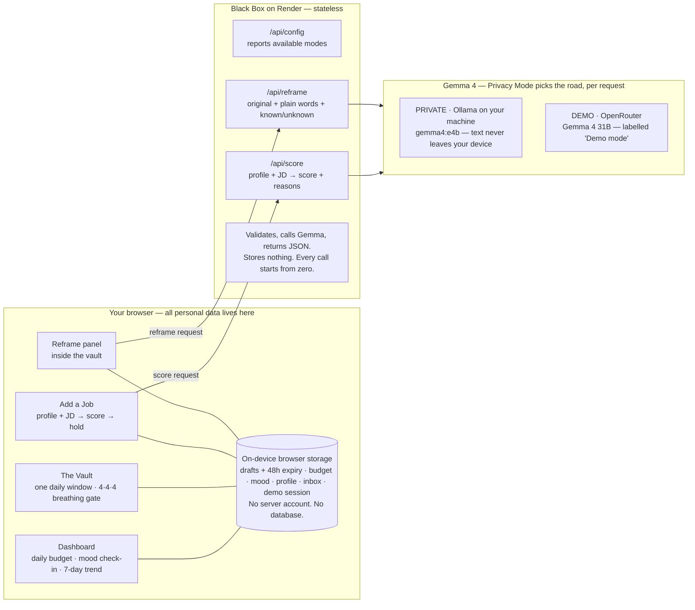
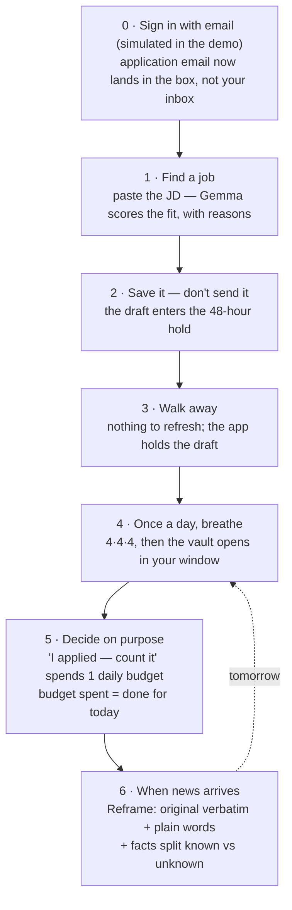

# Black Box — how it works

One rule drives the design: **the app holds your drafts and your limits, so
you don't have to hold the urge.**

Whichever inference road ran is printed on every result. No silent
substitutions.

## A day with Black Box

